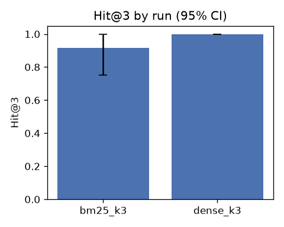

# rag-eval report

Generated by rag-eval 0.1.0. Every metric is shown as `mean [95% bootstrap CI] (n = questions it applies to)`.

| Run | System | k | Questions | Errors | Questions sha256 | Judge model | rag-eval | Created (UTC) |
|---|---|---|---|---|---|---|---|---|
| bm25_k3 | examples.toy_handbook.systems:make_bm25 | 3 | 15 | 0 | `2e74b203b7db` | none (retrieval only) | 0.1.0 | 2026-11-07T09:51:52+00:00 |
| dense_k3 | examples.toy_handbook.systems:make_dense | 3 | 15 | 0 | `2e74b203b7db` | none (retrieval only) | 0.1.0 | 2026-11-07T09:52:56+00:00 |

## Main results

| Run | Hit@3 | Recall@3 | MRR | Groundedness | Citation precision | Refusal accuracy | p50 latency (ms) | p95 latency (ms) |
|---|---|---|---|---|---|---|---|---|
| bm25_k3 | 0.917 [0.750, 1.000] (n=12) | 0.833 [0.666, 1.000] (n=12) | 0.819 [0.625, 1.000] (n=12) | - | - | - | 0 | 1 |
| dense_k3 | 1.000 [1.000, 1.000] (n=12) | 0.917 [0.792, 1.000] (n=12) | 0.903 [0.764, 1.000] (n=12) | - | - | - | 11 | 16 |

## Diagnostics

| Run | Precision@3 |
|---|---|
| bm25_k3 | 0.361 [0.278, 0.444] (n=12) |
| dense_k3 | 0.389 [0.333, 0.472] (n=12) |

_No answer metrics: these runs were retrieval-only._

## Charts

## Per-qtype results

### Hit@3 by qtype

| qtype | bm25_k3 | dense_k3 |
|---|---|---|
| lookup | 1.000 [1.000, 1.000] (n=5) | 1.000 [1.000, 1.000] (n=5) |
| multi_passage | 1.000 [1.000, 1.000] (n=4) | 1.000 [1.000, 1.000] (n=4) |
| paraphrase | 0.667 [0.000, 1.000] (n=3) | 1.000 [1.000, 1.000] (n=3) |
| unanswerable | - | - |

### Recall@3 by qtype

| qtype | bm25_k3 | dense_k3 |
|---|---|---|
| lookup | 1.000 [1.000, 1.000] (n=5) | 1.000 [1.000, 1.000] (n=5) |
| multi_passage | 0.750 [0.500, 1.000] (n=4) | 0.750 [0.500, 1.000] (n=4) |
| paraphrase | 0.667 [0.000, 1.000] (n=3) | 1.000 [1.000, 1.000] (n=3) |
| unanswerable | - | - |

### MRR by qtype

| qtype | bm25_k3 | dense_k3 |
|---|---|---|
| lookup | 1.000 [1.000, 1.000] (n=5) | 0.900 [0.700, 1.000] (n=5) |
| multi_passage | 0.833 [0.500, 1.000] (n=4) | 0.833 [0.500, 1.000] (n=4) |
| paraphrase | 0.500 [0.000, 1.000] (n=3) | 1.000 [1.000, 1.000] (n=3) |
| unanswerable | - | - |

## Failure log (5 worst questions per run)

Sorted by lowest recall, then lowest groundedness.

### bm25_k3

| Question | qtype | Recall | Groundedness | Retrieved | Gold | Missed gold |
|---|---|---|---|---|---|---|
| q11 | paraphrase | 0.00 | - | `equipment-02`, `benefits-05`, `travel-01` | `benefits-04` | `benefits-04` |
| q08 | multi_passage | 0.50 | - | `security-02`, `equipment-01`, `security-04` | `equipment-04`, `security-04` | `equipment-04` |
| q09 | multi_passage | 0.50 | - | `equipment-02`, `equipment-04`, `benefits-04` | `equipment-02`, `equipment-03` | `equipment-03` |
| q01 | lookup | 1.00 | - | `leave-01`, `benefits-03`, `leave-06` | `leave-01` | - |
| q02 | lookup | 1.00 | - | `travel-03`, `benefits-02`, `benefits-05` | `travel-03` | - |

### dense_k3

| Question | qtype | Recall | Groundedness | Retrieved | Gold | Missed gold |
|---|---|---|---|---|---|---|
| q08 | multi_passage | 0.50 | - | `equipment-05`, `security-02`, `equipment-04` | `equipment-04`, `security-04` | `security-04` |
| q09 | multi_passage | 0.50 | - | `equipment-02`, `equipment-04`, `equipment-05` | `equipment-02`, `equipment-03` | `equipment-03` |
| q01 | lookup | 1.00 | - | `leave-02`, `leave-01`, `benefits-03` | `leave-01` | - |
| q02 | lookup | 1.00 | - | `travel-03`, `travel-04`, `travel-02` | `travel-03` | - |
| q03 | lookup | 1.00 | - | `security-01`, `security-02`, `security-06` | `security-01` | - |
